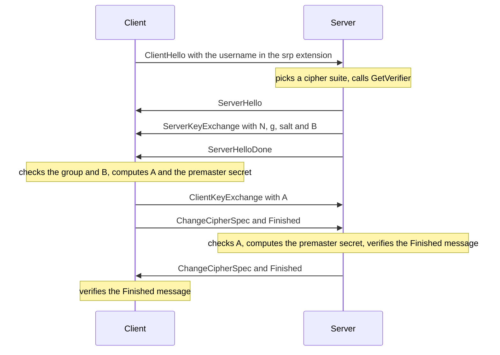

# Architecture

## Where the code comes from

The package is a trimmed copy of `crypto/tls` from Go 1.27.2. It keeps the record layer, the TLS 1.2 key schedule and the handshake message encoding. It replaces the key
exchange with SRP. Code that
SRP does not use is removed: TLS 1.3, session resumption, certificates, ALPN and QUIC.

| File | Content |
| --- | --- |
| `conn.go` | `Conn`, the record layer, CBC record protection, `Handshake`, `Read`, `Write` and `Close` |
| `common.go` | `Config`, `ConnectionState`, `ClientHelloInfo` and the sentinel errors |
| `tls.go` | `Client`, `Server`, `Listen` and `NewListener` |
| `handshake_server.go` | The server handshake |
| `handshake_client.go` | The client handshake, which follows the TLS 1.2 part of Go's client |
| `handshake_messages.go` | Encoding and parsing of the handshake messages, including the SRP structures |
| `cipher_suites.go` | The three SRP cipher suites |
| `prf.go` | The TLS 1.2 PRF, the master secret, Extended Master Secret and exported keying material |
| `alert.go` | TLS alerts |
| `srp.go` | Groups, verifiers, `SimulatedVerifier` and the SRP computations |
| `groups_rfc5054.go` | The primes and generators of RFC 5054, Appendix A |

`alert.go`, `cipher_suites.go`, `common.go`, `conn.go`, `handshake_messages.go`,
`handshake_server.go`, `prf.go` and `tls.go` are tracked against the same files in newer Go
releases, so that fixes to Go's TLS code are ported. [Development](development/development.md#following-go-releases)
describes the check.

The SRP arithmetic uses [filippo.io/bigmod](https://pkg.go.dev/filippo.io/bigmod), the
constant-time modular arithmetic of the Go standard library exported as a module. Messages are
parsed with `golang.org/x/crypto/cryptobyte`, as in `crypto/tls`.

## The handshake

Every connection runs a full TLS 1.2 handshake with the SRP key exchange of
[RFC 5054, Section 2.2](https://www.rfc-editor.org/rfc/rfc5054#section-2.2). There is no certificate
message and no signature.

The server computes `B = k*v + g^b mod N` from the stored verifier `v`. The client computes the
premaster secret from the password and the server from the verifier
([RFC 5054, Section 2.6](https://www.rfc-editor.org/rfc/rfc5054#section-2.6)). Both arrive at the same
value only when the verifier was made from the password the client used. Nothing else in the
handshake checks the password.

With a wrong password the two sides derive different keys. The server cannot decrypt the client's
Finished message and sends a `bad_record_mac` alert, which the client reports as a wrong password. A
server that does not hold the verifier cannot produce a Finished message the client can decrypt, so
the client ends the handshake with its own `bad_record_mac` alert. That is how the client
authenticates the server without a certificate.

The random exponents `a` and `b` are 384 bits long. RFC 5054 requires that `A` and `B` are
not zero modulo `N`. The package also refuses values that are not below `N` or that give `u = 0`. A
failed check ends the handshake with an `illegal_parameter` alert.

## When the handshake runs

The handshake runs when `Handshake` or `HandshakeContext` is called or on the first `Read` or `Write`.
It runs once. A failed handshake stores its error and every later call to `Handshake`, `Read` and
`Write` returns it. After a canceled `HandshakeContext` the stored error is the one from the closed
connection, not the context error.

On the server, `GetVerifier` is called once per handshake, after the cipher suite is chosen and before
any SRP computation. Its `ClientHelloInfo.Context` is canceled when the handshake ends.
